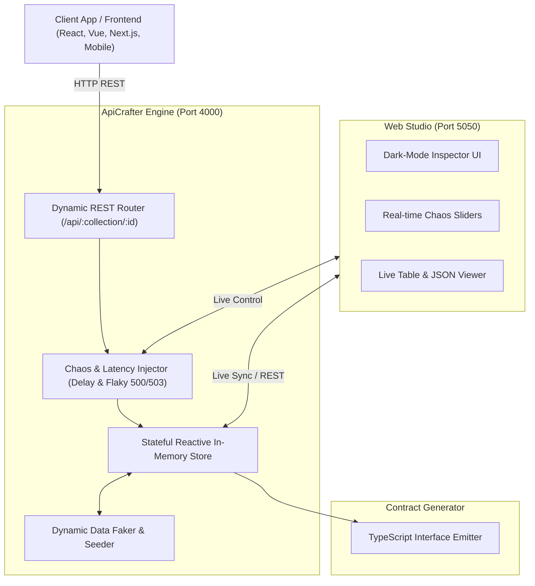

# ⚡ ApiCrafter

> **Zero-Dependency Stateful REST Mock Engine, Dynamic Chaos Latency Simulator & Interactive Dark-Mode Web Studio.**  
> Crafted by **[Jatin Sharma](https://jatinsh.netlify.app/)** • GitHub: **[@raghav1924](https://github.com/raghav1924)**

[](https://opensource.org/licenses/MIT)
[](https://nodejs.org/)
[](https://www.typescriptlang.org/)
[](https://github.com/raghav1924/apicrafter)
[](https://jatinsh.netlify.app/)

---

## 🌟 Why ApiCrafter?

Frontend developers and full-stack engineers frequently hit a bottleneck: **backend APIs aren't ready yet, or third-party sandboxes are slow, brittle, or require complicated setup.**

Static mock servers (`json-server`, static JSON fixtures) fall short because:
1. **No In-Memory Statefulness:** Mutating endpoints (`POST`, `PUT`, `DELETE`) don't actually update in-memory tables.
2. **No Chaos or Flakiness Simulation:** Real-world networks drop packets, spike latency, or throw 500s/503s. Without chaos testing, frontend loading skeletons and error boundaries go untested until production.
3. **Bloated Dependencies:** Most solutions pull hundreds of megabytes of npm dependencies.

**ApiCrafter** solves this in a single, high-performance, **zero-dependency** TypeScript package:
- 🚀 **Instant Stateful REST Engine:** Full CRUD mutations on in-memory collections (`/api/users`, `/api/products`, `/api/orders`, or custom resources) that persist across requests.
- ⚡ **Chaos & Latency Simulator:** Inject artificial latency (`--delay 350`) or probabilistic error rates (`--chaos 0.2`) on the fly.
- 🎨 **Modern Dark-Mode Web Studio:** Real-time visual dashboard at port `5050` with live collection inspectors, instant JSON editing, and interactive chaos sliders.
- 📐 **Instant TypeScript Type Generation:** Generate strict TypeScript interface contracts directly from your live mock collections (`apicrafter types --out types.ts`).
- 🛡️ **Zero Dependencies:** Built exclusively on Node.js standard libraries for lightning-fast execution, zero security attack surface, and minimal footprint.

---

## 🏗️ Architecture Overview



---

## 🚀 Quickstart

### 1. Run via NPX or Local CLI
```bash
# Clone the repository
git clone https://github.com/raghav1924/apicrafter.git
cd apicrafter

# Build the project
npm run build

# Run the CLI
./dist/bin.js start
```

### 2. Available Commands
```bash
# Start REST engine on port 4000 and Visual Studio on port 5050
apicrafter start

# Start with custom base latency and 15% random failure rate
apicrafter start --delay 350 --chaos 0.15

# Disable web studio if running in headless CI
apicrafter start --no-web --port 8080

# Generate TypeScript interfaces from seeded models
apicrafter types --out ./src/types/api.ts

# Dump seed mock collections as JSON
apicrafter seed > seed.json
```

---

## 📡 REST API Endpoints

ApiCrafter automatically exposes full RESTful CRUD endpoints for all seeded collections:

| Method | Endpoint | Description |
|---|---|---|
| `GET` | `/api/:collection` | Fetch all items (supports `?limit=10&status=active` query filtering) |
| `GET` | `/api/:collection/:id` | Fetch a single item by its ID |
| `POST` | `/api/:collection` | Create a new record (auto-assigns ID and timestamps) |
| `PUT` | `/api/:collection/:id` | Full update of existing record |
| `PATCH` | `/api/:collection/:id` | Partial update of existing record |
| `DELETE` | `/api/:collection/:id` | Remove record from in-memory collection |

### Example cURL Queries
```bash
# 1. List users
curl -s http://localhost:4000/api/users | jq .

# 2. Filter users by role
curl -s "http://localhost:4000/api/users?role=engineer" | jq .

# 3. Create a new user
curl -s -X POST http://localhost:4000/api/users \
  -H "Content-Type: application/json" \
  -d '{"name":"Alex Rivers","email":"alex@example.com","role":"architect"}' | jq .

# 4. Delete user
curl -s -X DELETE http://localhost:4000/api/users/id_12345
```

---

## 🎨 Interactive Dark-Mode Web Studio

When you launch `apicrafter start`, open **`http://localhost:5050`** in your browser to access the Web Studio:

- **📊 Live Collection Browser:** View, search, and inspect in-memory records across `users`, `products`, `orders`, and custom schemas.
- **⚡ Interactive Chaos Tuner:** Adjust base network latency (0ms to 3000ms) and chaos error rates (0% to 50%) in real time without restarting the server.
- **🔄 Instant Reset:** Flush and re-seed collections with realistic mock data in one click.
- **📐 TypeScript Exporter:** Preview generated TypeScript interfaces directly in the browser.

---

## 📐 TypeScript Type Generation

Run `apicrafter types` to generate compile-time TypeScript type definitions from your mock state:

```typescript
/**
 * Auto-generated by ApiCrafter (https://github.com/raghav1924/apicrafter)
 * Author: Jatin Sharma (https://jatinsh.netlify.app/)
 */

export interface User {
  id: string;
  name: string;
  email: string;
  role: string;
  created_at: string;
}

export interface Product {
  id: string;
  name: string;
  price: number;
  status: string;
  stock: number;
}

export interface Order {
  id: string;
  user_id: string;
  amount: number;
  status: string;
  created_at: string;
}
```

---

## 🧪 Testing

ApiCrafter includes comprehensive unit tests using the native Node.js test runner:

```bash
npm test
```

Expected output:
```
▶ TypeScriptTypeGenerator
  ✔ generates valid typescript interface definitions
✔ TypeScriptTypeGenerator
▶ MemoryStore CRUD & State Management
  ✔ initializes with default collections (users, products, orders)
  ✔ creates and retrieves a single item
  ✔ updates an existing item with partial fields
  ✔ deletes an item and decreases count
  ✔ resets collections back to initial default seed state
✔ MemoryStore CRUD & State Management
ℹ tests 6
ℹ pass 6
ℹ fail 0
```

---

## 👨‍💻 Author

**Jatin Sharma**  
- Portfolio: **[https://jatinsh.netlify.app/](https://jatinsh.netlify.app/)**  
- GitHub: **[@raghav1924](https://github.com/raghav1924)**  
- Email: [raghavjatin245@gmail.com](mailto:raghavjatin245@gmail.com)

---

## 📄 License

This project is licensed under the **MIT License** — see the [LICENSE](LICENSE) file for details.
